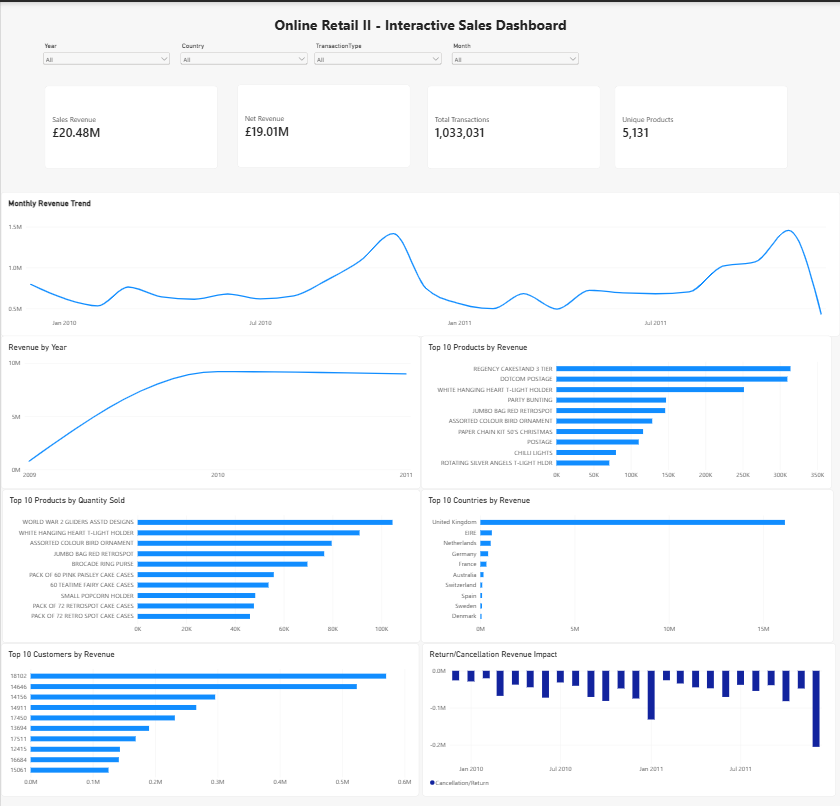

# SWYNEX Interactive Dashboard

## Task 3 — Interactive Dashboard

This project is part of my Data Analytics Internship with **SWYNEX Technologies**.

The objective of this task was to transform the cleaned **Online Retail II** dataset into an interactive business dashboard using **Microsoft Power BI**.

The dashboard provides an interactive view of sales performance, revenue trends, product performance, customer contribution, country-level revenue, and return/cancellation impact.

---

## Dashboard Preview

---

## Project Objective

The main objectives of this dashboard are to:

- Monitor important sales and revenue KPIs.
- Analyze monthly and yearly revenue trends.
- Identify top-performing products.
- Analyze products by quantity sold.
- Compare revenue across countries.
- Identify top customers by revenue.
- Analyze return/cancellation revenue impact.
- Provide interactive filtering for business analysis.

---

## Dataset

The dashboard uses the cleaned **Online Retail II** dataset prepared during Task 1 of the SWYNEX Data Analytics Internship.

### Dataset Overview

- **Total Records:** 1,033,031
- **Columns:** 16
- **Products:** 5,131 unique products
- **Countries:** 43
- **Identified Customers:** 5,942

Revenue is calculated using:

**Revenue = Quantity × Price**

The dashboard distinguishes between **Sales Revenue** and **Net Revenue**.

- **Sales Revenue:** Revenue from Sale transactions.
- **Net Revenue:** Revenue across all transaction types, including sales and returns/cancellations.

---

## Dashboard KPIs

The dashboard contains four key performance indicators:

| KPI | Value |
|---|---:|
| Sales Revenue | £20.48M |
| Net Revenue | £19.01M |
| Total Transactions | 1,033,031 |
| Unique Products | 5,131 |

---

## Dashboard Visualizations

The dashboard includes the following visualizations:

### 1. Monthly Revenue Trend

Shows how revenue changes over time across the available months.

### 2. Revenue by Year

Compares overall revenue performance across different years.

### 3. Top 10 Products by Revenue

Identifies the products generating the highest revenue.

### 4. Top 10 Products by Quantity Sold

Shows the products with the highest sales quantity.

### 5. Top 10 Countries by Revenue

Highlights the countries contributing the most revenue.

### 6. Top 10 Customers by Revenue

Identifies the highest-value customers based on revenue contribution.

### 7. Return/Cancellation Revenue Impact

Shows the negative revenue impact associated with cancellation/return transactions.

---

## Interactive Filters

The dashboard includes four interactive slicers:

- **Year**
- **Country**
- **Transaction Type**
- **Month**

These filters allow users to explore the dashboard dynamically and analyze specific segments of the retail data.

For example, users can select a specific country such as Germany and instantly view the corresponding revenue, transactions, products, customers, and trends.

---

## Key Insights

The dashboard provides several important business insights:

- The **United Kingdom** is the dominant revenue-generating market.
- Revenue shows significant monthly variation across the analysis period.
- A relatively small number of products contribute a significant share of revenue.
- High-value customers make a substantial contribution to overall revenue.
- Return and cancellation transactions have a negative impact on net revenue.
- Interactive filters allow users to analyze performance by year, country, transaction type, and month.

---

## Learning Outcomes

Through this task, I gained practical experience in:

- Building interactive dashboards using Power BI.
- Creating KPI cards.
- Creating and formatting charts.
- Creating DAX measures.
- Using Power BI slicers and filters.
- Performing interactive business analysis.
- Presenting data-driven insights visually.
- Designing a professional BI dashboard.

---

## Tools & Technologies

- **Microsoft Power BI Desktop**
- **Power Query**
- **DAX**
- **Online Retail II Dataset**
- **Git**
- **GitHub**

---

## Project Structure

SWYNEX-Interactive-Dashboard/
│
├── SWYNEX-Interactive-Dashboard.pbix
├── README.md
│
└── screenshots/
    └── dashboard.png

---

## DAX Measures

The dashboard uses DAX measures to calculate important KPIs.

### Sales Revenue

Sales Revenue =
CALCULATE(
    SUM(online_retail_II_cleaned[Revenue]),
    online_retail_II_cleaned[TransactionType] = "Sale"
)

### Net Revenue

Net Revenue =
SUM(online_retail_II_cleaned[Revenue])

### Total Transactions

Total Transactions =
COUNTROWS(online_retail_II_cleaned)

### Unique Products

Unique Products =
DISTINCTCOUNT(online_retail_II_cleaned[StockCode])

---

## Data Analysis Approach

The dashboard was developed using the cleaned dataset prepared during the previous internship task.

The workflow included:

1. Importing the cleaned Online Retail II dataset into Power BI.
2. Reviewing the dataset structure.
3. Creating DAX measures for important KPIs.
4. Creating interactive slicers.
5. Creating revenue and product visualizations.
6. Creating customer and country analysis.
7. Creating return/cancellation analysis.
8. Formatting the dashboard for clear presentation.
9. Testing the interactive filters.
10. Saving the final Power BI dashboard.

---

## Dashboard Testing

The dashboard was tested using different filter combinations to verify that the visualizations and KPI values respond dynamically.

Test scenarios included:

- Selecting different years.
- Selecting different countries.
- Selecting different transaction types.
- Selecting different months.
- Combining multiple filters.
- Verifying KPI changes.
- Verifying chart changes.
- Checking return/cancellation impact.

The dashboard successfully responds to the applied filters.

---

## Internship

**Organization:** SWYNEX Technologies  
**Program:** Data Analytics Internship  
**Task:** Task 3 — Interactive Dashboard

---

## Author

**Kushal Shah**

MCA Student | Data Analytics | Python | Power BI

---

## Conclusion

The **SWYNEX Interactive Dashboard** converts the cleaned Online Retail II dataset into an interactive business intelligence solution.

It provides a consolidated view of revenue, transactions, products, customers, countries, and return/cancellation activity while allowing users to interactively explore the data using multiple filters.

This task provided practical experience in **Power BI, DAX, data visualization, dashboard design, and interactive business analysis**.